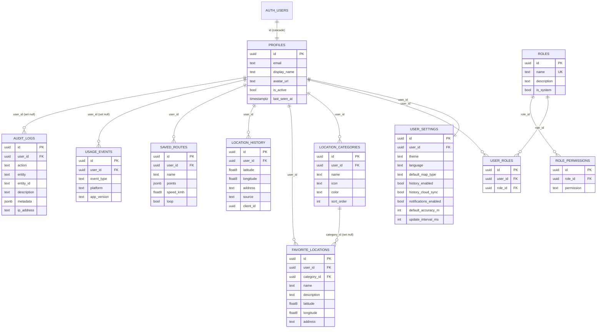

# Database (Supabase PostgreSQL)

Schema is versioned in `supabase/migrations`. All primary keys are `uuid`, timestamps are `timestamptz`.

Standalone tables: `system_settings`, `app_versions`, `announcements`, `contact_messages`.

## Rules

* `handle_new_user()` trigger on `auth.users` creates profile, settings, `user` role and the 5 default
  categories (Work, Home, Test locations, Cities, Custom — localised names stored per user language).
* RLS on user tables: owner only (`auth.uid() = user_id`).
* Backend-only tables (`roles`, `role_permissions`, `user_roles`, `audit_logs`, `system_settings`,
  `contact_messages`, `usage_events`, `app_versions`, `announcements`): no access for `anon` /
  `authenticated`.
* `profiles`: owner can read; `is_active` and `email` are not updatable by the user (column grants).
* Storage buckets: `avatars` (private, `<user_id>/...` path policy), `releases` (public read, backend write).
